<div align="center">

# Remote Access Protocol (RAP)

**Control one Windows PC from another over a small, readable wire protocol.**

[](https://github.com/Bidyut-Kr-Das/remote-access-protocol/releases/latest)
[](https://github.com/Bidyut-Kr-Das/remote-access-protocol/actions/workflows/release.yml)
[](go.mod)
[](#requirements)

[](#building-from-source)

</div>

---

## What it is

RAP is a remote-control tool for Windows, made of two programs and one custom protocol (v1):

| Binary | Runs on | Job |
|---|---|---|
| `raphost.exe` | **PC B**, the one being controlled | Shares its primary screen and replays the mouse and keyboard input it receives |
| `rapview.exe` | **PC A**, the one you sit at | Opens a window showing B's screen and forwards your input to B |

It works directly on a LAN, or over the internet using the built-in Tailscale support (the `-tsnet` flag) or a separately installed Tailscale or ZeroTier overlay network. Everything runs over **one TCP connection per session**, and the full wire format is in [`docs/protocol-design.md`](docs/protocol-design.md).

## Features

- **Live screen**: the host captures its primary display every 100 ms and sends it as a JPEG (quality 70). If the previous frame is still sending, that tick is skipped instead of queued, so a slow link gets choppy rather than delayed.
- **Full input forwarding**: mouse move, left/right/middle buttons, wheel, and keyboard (including auto-repeat for held keys). Clicks land where you point, even when the window is resized; the aspect ratio is kept.
- **Capture toggle**: `Ctrl+Alt+Home` switches between CAPTURED (input goes to B) and RELEASED (input stays on A; B is view-only). Releasing lifts every key and button still held on B.
- **Clipboard text sync** in both directions, in both capture modes: text up to 256 KB, appearing on the other PC within about half a second, with no ping-pong re-copies.
- **Password auth**: challenge-response (`sha256(password || nonce)`), the password itself never crosses the wire. Three wrong passwords lock an IP out for 60 seconds.
- **One session at a time**: a second viewer is refused while one is connected.
- **Keepalive**: the viewer pings every 2 s; 6 s of silence ends the session on either side, and the host releases any held input.
- **DPI aware**: the host uses per-monitor DPI awareness, so capture and input use physical pixels.

## Download

<!-- release:start -->
**Latest release: [`v1.0.1`](https://github.com/Bidyut-Kr-Das/remote-access-protocol/releases/tag/v1.0.1)** (2026-11-08) · [release notes](https://github.com/Bidyut-Kr-Das/remote-access-protocol/releases/tag/v1.0.1) · [raphost.exe](https://github.com/Bidyut-Kr-Das/remote-access-protocol/releases/download/v1.0.1/raphost.exe) · [rapview.exe](https://github.com/Bidyut-Kr-Das/remote-access-protocol/releases/download/v1.0.1/rapview.exe)
<!-- release:end -->

These links always point at the newest release:

- [**Download latest release**](https://github.com/Bidyut-Kr-Das/remote-access-protocol/releases/latest)
- [`raphost.exe`](https://github.com/Bidyut-Kr-Das/remote-access-protocol/releases/latest/download/raphost.exe) (for PC B, the controlled PC)
- [`rapview.exe`](https://github.com/Bidyut-Kr-Das/remote-access-protocol/releases/latest/download/rapview.exe) (for PC A, the PC you sit at)

## How it works

<p align="center">
  
</p>

On the **host**, three goroutines share the connection: a capture loop (screenshot, JPEG encode, hand off to a single sender), a clipboard poller, and the read loop, which answers pings, applies clipboard text, and passes input to the `SendInput` injector. On the **viewer**, a reader goroutine decodes frames into a backing image that the ebiten window draws, while the window's update loop turns your keys and mouse into protocol messages.

<p align="center">
  
</p>

A session starts with a challenge-response handshake. The host sends a random 32-byte nonce, the viewer answers with the protocol version and `sha256(password || nonce)`, and the host replies with `OK` plus its screen size, or `DENY`. After that, frames, input, keepalive and clipboard messages share the same connection until either side closes it.

Diagram sources (editable HTML) live in [`docs/diagrams/`](docs/diagrams/).

## Quick start

### Requirements

- Windows on both PCs.
- One of the following ways for the two PCs to reach each other:
  - both on the same LAN, or
  - a free Tailscale account for the built-in `-tsnet` mode, with both PCs signed into the same account (nothing else to install; see [Internet use](#internet-use-built-in-tailscale)), or
  - both on the same separately installed Tailscale/ZeroTier network.
- Go 1.27+ only if you build from source.

### 1. Start the host on PC B

```powershell
.\raphost.exe -password <pw>
```

| Flag | Default | Meaning |
|---|---|---|
| `-password` | (required) | Shared password |
| `-port` | `7700` | TCP port to listen on |
| `-tsnet` | off | Join your tailnet with the built-in Tailscale and listen there instead of on the LAN |
| `-relogin` | off | With `-tsnet`: forget the saved Tailscale login and sign in again, e.g. to switch account |

Allow it when Windows Firewall prompts (not needed with `-tsnet`). The host logs `listening on ... (<width>x<height>)` and then one line per session start and end.

### 2. Connect the viewer from PC A

```powershell
.\rapview.exe -host <B ip> -password <pw>
```

| Flag | Default | Meaning |
|---|---|---|
| `-host` | (required) | Host address (IP or DNS name) |
| `-password` | (required) | Shared password |
| `-port` | `7700` | Host TCP port |
| `-tsnet` | off | Connect through the built-in Tailscale; use with a host started with `-tsnet` |
| `-relogin` | off | With `-tsnet`: forget the saved Tailscale login and sign in again, e.g. to switch account |

A 1280x720 resizable window opens showing B's desktop, in CAPTURED mode.

### Hotkey

`Ctrl+Alt+Home` toggles capture mode (shown in the window title). The chord itself is never sent to B.

- **CAPTURED**: keyboard and mouse on A go to B.
- **RELEASED**: input stays on A; B is view-only.

### Exit codes

| Program | `0` | `1` | `2` |
|---|---|---|---|
| `rapview` | Window closed normally | Session dropped (title shows "Disconnected", window closes after 2 s) | Bad flags, connection failed, wrong password or host busy |
| `raphost` | (runs until stopped) | Could not read screen size, listen, or accept | Bad flags / missing `-password` |

## Building from source

```powershell
git clone https://github.com/Bidyut-Kr-Das/remote-access-protocol.git
cd remote-access-protocol
go test ./...
go build -o raphost.exe ./cmd/raphost
go build -o rapview.exe ./cmd/rapview
```

The Go module is `rap`. CI ([`.github/workflows/release.yml`](.github/workflows/release.yml)) runs the same test and build steps on `windows-latest` for every push and pull request to `main`.

### Releasing

Push a tag that starts with `v` (for example `git tag v1.0.0 && git push origin v1.0.0`). CI then:

1. tests and builds both binaries,
2. publishes a GitHub release named after the tag with `raphost.exe` and `rapview.exe` attached (the tagged commit's message becomes the release notes),
3. rewrites the [Download](#download) block in this README on the default branch with the new tag, date, release-notes link and direct download links.

## Internet use (built-in Tailscale)

Both binaries embed Tailscale ([tsnet](https://pkg.go.dev/tailscale.com/tsnet)), so nothing else needs installing. You need a free Tailscale account.

1. On B, run `raphost -password <pw> -tsnet`. The first run prints a login URL; open it and sign in. B joins your tailnet as `rap-<computer name>` (printed on startup).
2. On A, run `rapview -host rap-<B's computer name> -password <pw> -tsnet`. The first run prints a login URL; sign in with the **same** Tailscale account.

Login state is saved in a `tsnet-*` folder under `%AppData%`, so later runs connect directly. To sign in with a different Tailscale account, add `-relogin`: it keeps that folder's device identity and prints a new login URL, so the same account reuses the same device entry. No firewall rule is needed: the embedded node only makes outbound connections. Traffic is WireGuard-encrypted end to end; Tailscale's relays (DERP) carry it when a direct path cannot be punched.

## Internet use (via a separate Tailscale or ZeroTier install)

Without `-tsnet`, put both PCs on one overlay network and use the overlay IP:

1. Install Tailscale (or ZeroTier) on A and B and sign both into the same network.
2. On B, run `raphost` as above. When Windows Firewall prompts, allow it on **both Private and Public** networks: the overlay adapter is often classified as Public, and a Private-only rule silently drops the connection.
3. On A, run `rapview -host <B's overlay IP or MagicDNS name> -password <pw>`. Tailscale IPs look like `100.x.y.z`; `tailscale ip -4` on B prints it.

The overlay encrypts everything end to end (WireGuard), so the plaintext wire format is not exposed on the internet. Frame rate drops on a slow upload from B: capture skips ticks while the previous frame is still sending, so it gets choppy rather than lagging behind.

## Protocol overview

Every message is framed as:

```
[u32 big-endian length][u8 type][payload]      length = 1 + len(payload), max 16 MiB
```

Before authentication, reads are capped at 64 bytes. All integers are big-endian.

| Type | Name | Direction | Payload |
|---|---|---|---|
| `0x01` | `CHALLENGE` | host → viewer | `nonce [32]byte` |
| `0x02` | `HELLO` | viewer → host | `version u8` (= 1), `hash [32]byte` = `sha256(password \|\| nonce)` |
| `0x03` | `OK` | host → viewer | `width u16`, `height u16` |
| `0x04` | `DENY` | host → viewer | (empty) |
| `0x10` | `FRAME` | host → viewer | `x, y, w, h u16`, `codec u8` (1 = JPEG), image data |
| `0x20` | `MOUSE_MOVE` | viewer → host | `x, y u16` in host screen pixels |
| `0x21` | `MOUSE_BUTTON` | viewer → host | `button u8` (1 left, 2 right, 3 middle), `down u8` |
| `0x22` | `MOUSE_WHEEL` | viewer → host | `delta i16` (120 per notch) |
| `0x23` | `KEY` | viewer → host | `vk u16` (Windows virtual-key code), `down u8` |
| `0x24` | `RELEASE` | viewer → host | (empty): host lifts every held key and button |
| `0x30` | `PING` | viewer → host | (empty), every 2 s |
| `0x31` | `PONG` | host → viewer | (empty) |
| `0x40` | `CLIPBOARD` | both ways | UTF-8 text, max 256 KiB |

## Project layout

```
cmd/
  raphost/            host agent: listener, per-session capture / input / clipboard loops, DPI awareness
  rapview/            viewer: connection, ebiten window, hotkey, input forwarding
internal/
  protocol/           message types, framing, handshake, per-IP failure limiter
  host/               session manager: handshake, one active session at a time
  capture/            primary-display screenshot -> JPEG FRAME
  input/              SendInput injector that tracks and releases held keys/buttons
  clipboard/          text clipboard polling and sync without echo
  view/               viewer geometry (letterbox, cursor mapping) and key table
docs/
  diagrams/               diagram sources (.html) and exported .svg
  protocol-design.md      design spec (wire protocol and transports)
  implementation-plan.md  original v1 implementation plan
.github/workflows/    CI build, release, README release block
```

## Troubleshooting

| Symptom | Likely cause / fix |
|---|---|
| Viewer cannot connect at all | Windows Firewall on B. Allow `raphost` on the network type in use; over Tailscale/ZeroTier allow **Public** too. Check the port matches on both sides. |
| `rapview: protocol: denied` | Wrong password, or another viewer is already connected. |
| `rapview: EOF` right after connecting | This IP is locked out after 3 wrong passwords; wait 60 s. |
| Window title says "Disconnected" | No data from the host for 6 s (network drop, host stopped, or B asleep). Restart `rapview`; there is no auto-reconnect. |
| Screen stops updating at UAC prompts or the login screen | The secure desktop cannot be captured; frames resume when it closes. |
| Clicks or keys do nothing in some windows | Windows blocks input into elevated (administrator) windows (UIPI) unless `raphost` itself runs elevated. |
| Win key, Alt+Tab or Ctrl+Alt+Del act on A | The OS keeps these; they are not forwarded. |
| Choppy picture over the internet | B's upload is the limit; frames are skipped rather than queued. |
| With `-tsnet`, the program waits and keeps repeating a login URL | That PC is not signed in to Tailscale yet. Open the URL in a browser and sign in; the program continues on its own once sign-in finishes. |
| With `-tsnet`, the viewer cannot reach the host | Make sure both PCs are signed into the **same** Tailscale account. If the `rap-<computer name>` name does not resolve, pass the `100.x.y.z` IP that `raphost` prints on startup to `-host` instead. |

## Known limits (v1 non-goals)

- Own NAT traversal / relay: internet use goes through Tailscale (`-tsnet`) or another overlay.
- TLS. The password is challenge-hashed; frame data is plaintext on the wire (safe inside an overlay tunnel such as `-tsnet`, not on an open internet port).
- Login screen, UAC prompts, session 0 capture.
- Clipboard images/files, audio, file transfer, multi-monitor.
- Auto-reconnect.
- Forwarding Win key, Alt+Tab, Ctrl+Alt+Del from A.
- Input into windows running as administrator is blocked by Windows (UIPI) unless `raphost` itself runs elevated.

## Acceptance checklist (two PCs, not yet run)

Start `.\raphost.exe -password test123` on B, `.\rapview.exe -host <B ip> -password test123` on A. Expect B's desktop, title CAPTURED. Record pass/fail:

- [ ] 1. Open Notepad on B via A's mouse; type `hello` → appears on B.
- [ ] 2. Ctrl+Alt+Home; type → lands on A, not B; title RELEASED.
- [ ] 3. Ctrl+Alt+Home again; type → lands on B.
- [ ] 4. Hold `a` on A, kill rapview → B stops repeating `a` within 1 s.
- [ ] 5. Wrong password ×3 → right password refused for 60 s, then works.
- [ ] 6. Resize rapview window → aspect kept, clicks land where pointed.
- [ ] 7. Copy text on A, paste on B; copy on B, paste on A → both arrive; no ping-pong re-copies.
- [ ] 8. A and B on different networks, both on Tailscale; `-host <B tailscale ip>` → connects, items 1–7 pass.
- [ ] 9. A and B on different networks with no Tailscale installed; run both with `-tsnet`, sign in with the same account; `-host rap-<B's computer name>` (or the 100.x IP raphost prints) → connects, items 1–7 pass.
